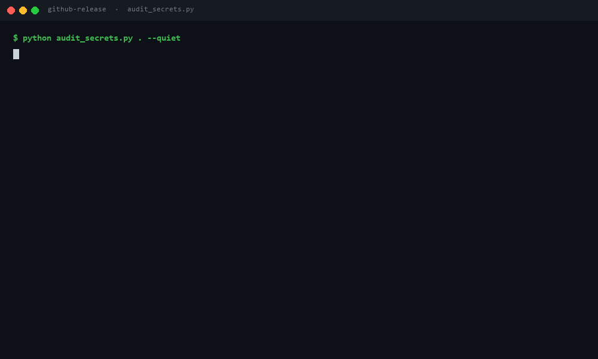

# github-release



**发布前给自己踩刹车：先扫脱敏，再查四件套，最后验证别人 clone 下来能跑。**

四个零依赖 Python 脚本 + 一份清单。把「发个开源仓库」从两小时的试错压到二十分钟。

---

## 它解决什么

把本地项目发到 GitHub，翻车方式就那么几种，而且每次都会忘：

| 翻车方式 | 后果 | 这里怎么防 |
|---|---|---|
| 域名 / 内网 IP / 本机路径没清 | 泄露服务器位置和用户名 | `audit_secrets.py` 扫出来，分「必须修 / 建议修」 |
| 学校名、服务名没换 | 配合 GitHub 账号能定位到本人 | 同上，内置常见单位名提示 |
| README 引用了不存在的文件 | 别人点进去 404 | `preflight.py` 校验所有相对链接 |
| 说「69 项测试全绿」但实际挂 1 个 | 面试官一 clone 就穿 | 发布前在副本上真跑一遍 |
| 只有 1 个 commit | 看不出开发过程 | 提示拆成有意义的提交 |

## 四个脚本

### `audit_secrets.py` — 脱敏审计

```bash
python audit_secrets.py <项目目录> --quiet
```

输出两档：

- **必须修**：真实 token、私钥块、本机绝对路径（`D:\Users\...`）、内网 IP（`10./192.168./100.64-127.`） <!-- noqa -->
- **建议修**：真实域名、邮箱、手机号、单位/学校名

退出码 1 表示还有「必须修」，可以直接接进 CI。

自动跳过 `.git`、`node_modules`、二进制文件，以及 `example.com` 这类文档常用域名，减少误报。CIDR 网段（`100.64.0.0/10`）不会被当成主机地址——代码里判断私网是正常逻辑。

### `preflight.py` — 发布前检查

```bash
python preflight.py <项目目录> --test "pytest -q"
```

检查：

- 四件套：`README.md`、`LICENSE`、`.gitignore`、`env.example`
- README 里所有相对链接指向的文件是否真的存在
- `git status` 是否干净、有没有 commit、commit 数够不够
- 可选：跑测试，失败即阻塞

### `push-repo.py` — 绕过 git push 的发布通道

```bash
python push-repo.py <local_dir> <owner/repo> --message "feat: ..."
```

当 `github.com:443` 不通、但 `api.github.com` 通时（国内网络很常见），`git push` 会卡死。这个脚本改走 Git Data API：blobs → tree → commit → ref，提交在服务端组装。

- 空仓库 409 → 先 PUT 一个文件点亮
- 不带 `base_tree` → 整棵树替换，被网页上传压平过的仓库一次修好
- 推完核对 ref 指向，不通过就报错，不假设成功

三个坑都踩过：端点必须带 `/repos/{owner}/{repo}` 前缀；长连接会中途断（`WinError 10060`），要指数退避重试；`git ls-files` 默认转义中文文件名，要 `-c core.quotepath=false`。

### `make-gif.py` — 录首屏演示

```bash
python make-gif.py --title "项目名" --command "<真实命令>" --run <工作目录> --out docs/demo.gif
```

不录屏：真实执行命令、捕获输出、用 Pillow 渲染成终端风格。GIF 里每一行都是实际跑出来的。

三个坑：绝对路径会漏进图里（按 `--run` 归一化成 `./`）；Consolas 没有中日韩字形（按行切雅黑）；系统 Python 3.8 输出 GBK（subprocess 要 `encoding="utf-8"` + `PYTHONUTF8=1`）。

产物 29–32 KB，README 用 ``。

## 用法

```bash
# 1. 先把项目复制一份到发布目录，别在源码目录上动手
# 2. 审计
python audit_secrets.py ./my-project-public --quiet
# 3. 有「必须修」就改，改完再跑，直到 0 处
# 4. 检查四件套
python preflight.py ./my-project-public --test "pytest -q"
# 5. 推
```

完整的发布流程（认证方式选择、README 硬要求、发布后一小时内做什么）见 [SKILL.md](SKILL.md)。

## 一个必须知道的坑

**GitHub 网页上传会压平目录。**

实测：用网页「Upload files」传 91 个文件，设置 `File.webkitRelativePath` 后上传列表里显示 `core/pyproject.toml`，看起来成功了——但实际存储时只用了 `basename`，`docs/DEPLOY.md` 变成了根目录的 `DEPLOY.md`，85 个文件全平铺。

**任何有嵌套目录的项目必须走 `git push`。** 网页上传只适合单目录、少文件。

## 为什么做这个

发第三个开源项目时，前两次踩的坑又踩了一遍：网页上传压平、GCM 凭证失效、脱敏漏掉 `C:\Users\` 开头的路径。 <!-- noqa -->

把它固化下来——顺便，`audit_secrets.py` 第一次跑就抓到了我自己手工脱敏时漏掉的两处本机路径。

## License

MIT
